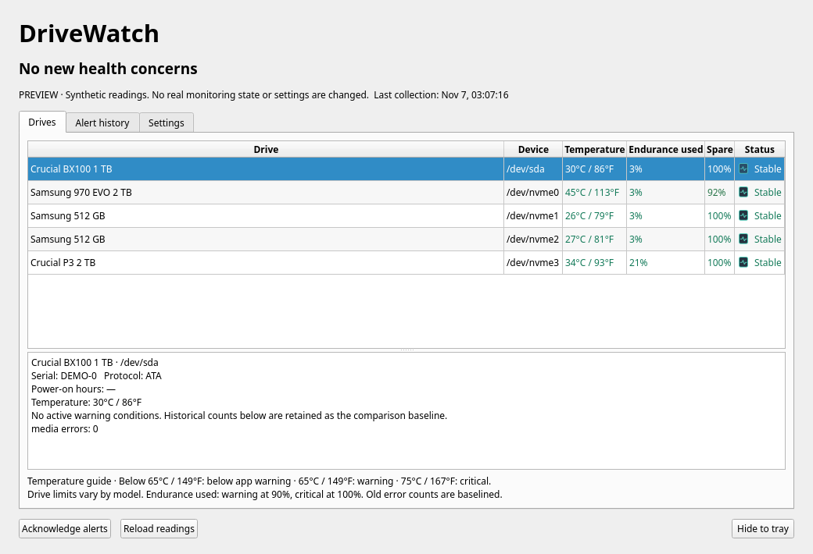
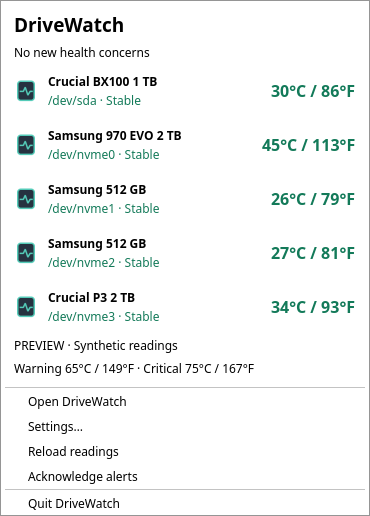
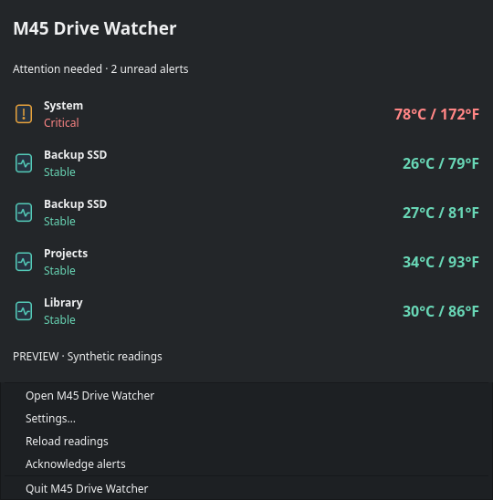
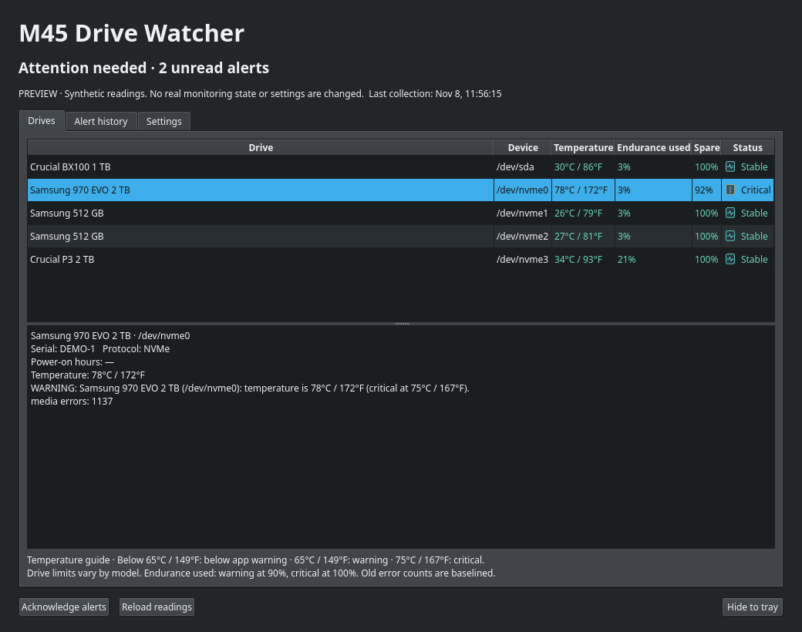
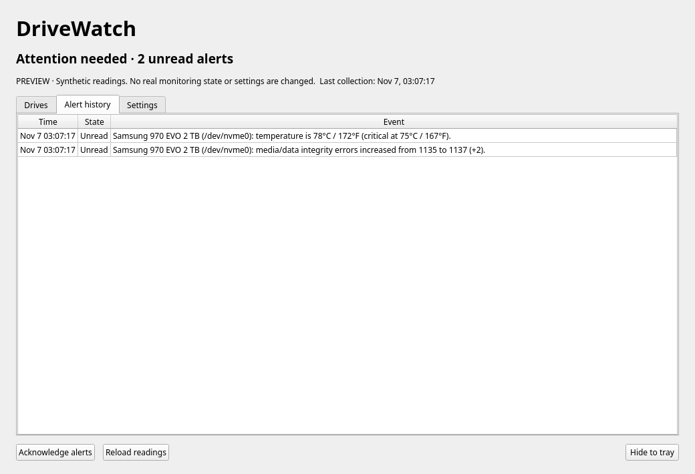
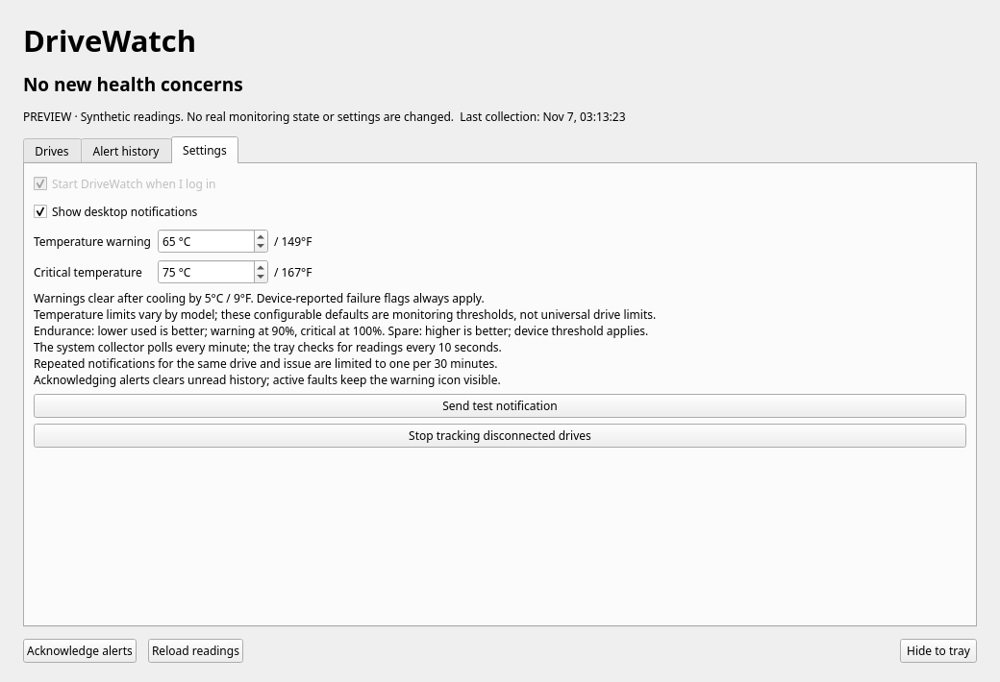
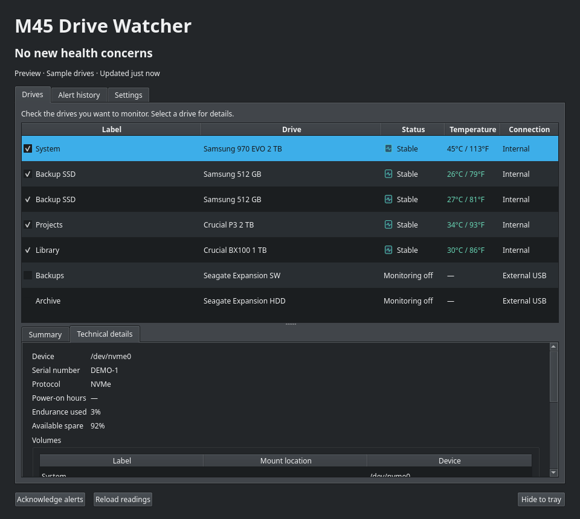

# M45 Drive Watcher



A small Linux tray app that watches for **new drive health problems**, with a compact click-to-open overview, desktop notifications, and persistent warning icons. Designed for KDE Plasma; uses Qt's StatusNotifierItem integration and follows your desktop palette.

Screenshots show synthetic data using a consistent dark theme. Fonts and colors follow the active desktop theme when running normally. The warning screenshot simulates new media errors and overheating; it is not a report about any real drive.

## Features

- Click the tray icon for drive temperatures, health status, Settings, and Quit. Double-click for the full overview.
- Green → amber → red gradients for temperature, endurance used, and spare capacity. Status text accompanies color.
- Temperatures in both Celsius and Fahrenheit, with explanations of the configured ranges.
- Persistent per-drive baselines keyed by model and serial, so device renumbering does not look like a replacement.
- New media errors, uncorrectable errors, reallocations, pending sectors, end-to-end errors, interface CRC errors, and decreasing spare capacity trigger alerts.
- Current SMART failure flags, NVMe critical warnings, failing ATA attributes, nonzero pending/offline-uncorrectable sectors, overheating, and worn-out endurance estimates warn even on first observation.
- Lifetime media errors and old thermal events are recorded as the initial baseline. Generic NVMe command error counts and unsafe shutdowns are visible, but do not independently trigger alerts.
- Warning icon remains until changes are acknowledged. Active faults remain visible even after acknowledgement.
- SMART read failures warn after 30 minutes of consecutive failed checks; a successful read resets the period. Missing drives, missing temperatures, invalid collector output, and stale readings remain explicit warnings.
- Summary shows the connection interface (NVMe, SATA, USB and other reported types) and negotiated link speed when available. These are connection rates, not measured file-transfer speeds. Missing speed data remains unavailable.
- The overview puts filesystem labels first, with drive models in a separate column, followed by status, temperature and connection. Alternating row backgrounds and additional padding separate each drive. Select a drive for a formatted Summary; device paths, mount locations, serials, counters and expandable diagnostics are in Technical details.
- Unsupported drives and USB drives whose SMART data cannot be read default to monitoring off. Explicit checkbox choices are preserved across refreshes and upgrades.
- Checkboxes choose which drives to monitor; choices survive restarts. Unchecked drives remain in the overview, without health, read-failure, or disconnection alerts, and are omitted from the tray popup. Existing alerts for that drive are acknowledged and retained in history. Re-enabling starts a fresh comparison baseline; current health faults still apply. The shared collector continues polling all drives.
- Device names, capacity, USB connections, partition labels, and mount locations come from system metadata even when SMART fails. External USB drives sort below internal drives.
- Login autostart enabled after installation, with a per-user toggle in Settings.
- No database, web server, Python packages, or KDE Frameworks dependencies.

## Install from the signed APT repository

The repository currently provides **amd64 packages built and tested on Ubuntu 24.04**. Other distributions are not yet tested.

Add the M45 Software public signing key and repository source using the setup package:

```sh
sudo apt install curl ca-certificates
curl -fLO https://m45software.com/apt/m45-software-archive-keyring_1.0_all.deb
printf '%s  %s\n' '64c664ec99234f244ec051e945ff604d8390966ef0d47df28c3ee39edc3d0fd1' 'm45-software-archive-keyring_1.0_all.deb' | sha256sum -c -
sudo apt install ./m45-software-archive-keyring_1.0_all.deb
sudo apt update
sudo apt install m45-drive-watcher
m45-drive-watcher --show
```

The setup package installs `/usr/share/keyrings/m45-software-archive-keyring.asc` and `/etc/apt/sources.list.d/m45-software.sources`. The source uses `Signed-By` to scope trust to this archive. Signing-key fingerprint: **`F8BD 2FC4 4347 3EB7 1D87 003B F8A7 E75C 58D7 C0A3`**.

For later updates:

```sh
sudo apt update
sudo apt install --only-upgrade m45-drive-watcher
```

Quit the running tray app and reopen it after upgrading. To remove the repository and its public key while keeping installed apps, run `sudo apt purge m45-software-archive-keyring`.

### Install a local package instead

Build a package as below, then install it on a machine running systemd and a desktop session:

```sh
sudo apt install ./build/m45-drive-watcher_0.1.11_amd64.deb
m45-drive-watcher --show
```

Package dependencies are resolved by apt. Launching manually starts the tray immediately; otherwise the global XDG autostart entry starts it at your next login. Package installation enables and starts the system collector timer automatically. Updates preserve the per-user startup preference and saved baselines.

The package replaces the former `drivewatch` package. Quit the old tray process before launching the renamed app. On first launch, existing DriveWatch baselines, settings, and per-user login preferences are copied to the new locations when no new data exists. The original files are retained. Preview mode never migrates real data.

Runtime dependencies: Qt 6 Core/GUI/Widgets/DBus and its platform plugins, Python 3.10+, smartmontools 7.3+, and systemd. Wayland support is recommended. Package library dependencies are derived from the build system; build on the oldest distribution release you intend to support. A package built for Ubuntu 24.04 is not guaranteed compatible with an older Debian/Ubuntu release.

## Build, test, and package

On Debian/Ubuntu:

```sh
sudo apt install build-essential cmake ninja-build qt6-base-dev python3 smartmontools dpkg-dev
cmake -S . -B build -G Ninja -DCMAKE_BUILD_TYPE=Release -DCMAKE_INSTALL_PREFIX=/usr
cmake --build build --parallel
ctest --test-dir build --output-on-failure
(cd build && cpack -G DEB)
```

The `.deb` is written to `build/`. Archive operators can publish tested packages using [the signed APT repository maintenance instructions](docs/apt-repository.md). GitHub Actions also builds and attaches a package artifact for pushes and pull requests. Release commits on `main` whose message starts with `Release v` publish a preview release after the build and tests pass, using matching notes in `docs/releases/vVERSION.md`. The tested release package is then published automatically to the signed APT repository. Manually published GitHub releases also deploy when they contain the matching `.deb` and `SHA256SUMS`; drafts do not deploy.

CI caches the downloaded Ubuntu packages listed in `.github/ci/apt-packages.txt`
and installs them without optional recommendations. APT still updates indexes,
resolves dependencies, and verifies packages. Daily cache keys include the runner
image, architecture, and dependency manifest; older matching caches seed new
keys. The first run fills the cache. C++ compilation uses a separate 250 MB
`ccache`, with hit/miss statistics in the build log. CMake configuration, tests,
and Debian packaging run normally. APT publication needs no development tools.

To try the interface before installing (synthetic data; no root required):

```sh
./build/m45-drive-watcher --demo
./build/m45-drive-watcher --demo --demo-warning --page tray
```

The demo does not change real settings, baselines, autostart preferences, or send desktop notifications.

## How monitoring works

`m45-drive-watcher-collector.timer` runs the root-owned, fixed-command collector once per minute. It discovers physical SATA/SAS/SCSI, NVMe namespaces, and MMC block devices from sysfs and runs `smartctl -x --json=o` with a 90-second timeout per drive. Devices explicitly reporting no SMART support show **SMART unavailable**, without repeated read-failure alerts. Failed queries show **SMART unavailable** and retain the 30-minute alert policy; a USB connection alone does not prove a drive lacks SMART. Neither state is a healthy-drive assessment. Failed queries retain the original SMART diagnostic output so USB command errors are visible. A bounded, read-only `lsblk` query supplies model/serial fallback, USB transport, capacity, filesystem labels and mount locations without mounting anything; sysfs supplies a further model/transport fallback. Device-mapper/RAID virtual volumes, loop devices, and partitions are excluded. Hardware behind RAID bridges may require extra smartctl support and is not automatically enumerated behind controllers.

The collector accepts no user commands or arguments and performs no repairs, formats, self-tests, firmware changes, or SMART enable/disable operations. It atomically writes `/run/m45-drive-watcher/snapshot.json`. This file is readable by local users and includes drive serial numbers, filesystem labels, and mount paths. The systemd service limits privileges and writes to its runtime directory; the desktop app never runs as root and does not launch privileged processes.

The desktop app reads the snapshot every 10 seconds. Data older than five minutes is a monitoring warning. Baselines, unread alerts, notification cooldowns, and up to 500 history entries persist in the user's XDG application data directory (normally `~/.local/share/M45Software/m45-drive-watcher/state.json`). If all 500 entries are unread, older entries are combined into a visible unread summary rather than silently discarded. Settings are normally in `~/.config/M45Software/m45-drive-watcher.conf`.

The collector continues when you quit the tray or turn off login autostart. **Desktop notifications require the tray app to be running.** The collector stores the latest snapshot rather than a time series: transient problems that appear and disappear while the tray is stopped may not be recorded, although cumulative counter changes are detected when it resumes. Polling may wake sleeping disks; the first release is aimed primarily at always-on SSD systems.

The service is deliberately independent of the login toggle. To disable collection as well:

```sh
sudo systemctl disable --now m45-drive-watcher-collector.timer
```

## Alert policy

| Reading | Initial behavior | Subsequent behavior |
|---|---|---|
| Lifetime media errors, reallocations, CRC errors | Save baseline | Alert on increase |
| Available spare | Warn at/below reported threshold | Also alert on decrease |
| SMART failure, NVMe critical flags, currently failing ATA attributes | Always warn | Warn on new fault or escalation |
| Pending/offline uncorrectable sectors | Warn when nonzero | Keep active until zero |
| Endurance used | Warning at 90%; critical at 100% | Escalate at threshold |
| Temperature | Warning at 65°C / 149°F; critical at 75°C / 167°F | Clear after cooling by 5°C / 9°F |
| Old thermal minutes, generic command errors, unsafe shutdowns | Display history | No standalone alert |
| Unreadable SMART data | Warn after 30 minutes of consecutive failed checks | Successful read resets the period |
| Missing drives or monitoring data | Explicit warning | Clear after recovery |

Temperature thresholds are configurable. They are conservative app settings, **not universal manufacturer operating limits**. Hardware-reported critical warnings always apply. Lower endurance use is better; higher available spare is better. Wear estimates do not predict remaining years. A historical nonzero media-error count does not alone color a drive red.

Read-failure confirmation persists across app restarts and uses fresh collector timestamps; a gap of more than five minutes between failed samples restarts confirmation. Pending failures remain visible in drive details without creating an alert or warning icon. Existing health faults remain active during read failures, and actual health failures still alert immediately.

Notifications for the same drive and issue/severity are limited to one per 30 minutes. Every detected change still enters the alert log and keeps the warning icon visible until acknowledged. Alert counts are health events, not a probability of failure. Notifications may be suppressed by your desktop's Do Not Disturb settings; the tray warning persists.

ATA raw attribute meanings are vendor dependent. M45 Drive Watcher watches commonly assigned attributes plus standardized ATA device statistics; specialized firmware may require model-specific handling. Large counters are stored as decimal strings. When a counter decreases, M45 Drive Watcher logs a reset warning and uses the new value as the baseline. Baselines survive formatting and cloning because they track the physical drive, not its filesystem.

For SATA drives that report a bogus current temperature of 0°C, M45 Drive Watcher can use the latest valid SCT temperature-history sample and labels it accordingly. It cannot prove that a firmware history sample is current.

## Screenshots








Regenerate dark-mode captures directly from the built app:

```sh
./scripts/render-screenshots.sh
```

## Troubleshooting and removal

```sh
systemctl status m45-drive-watcher-collector.timer m45-drive-watcher-collector.service
journalctl -u m45-drive-watcher-collector.service --since today
sudo /usr/libexec/m45-drive-watcher/collect
m45-drive-watcher --show
```

If a saved baseline is corrupt or inaccessible, the tray warns and stops updating it rather than overwriting the history. Preserve the file, fix its permissions or restore a backup, then restart. If no backup exists, moving it aside starts a new baseline and loses comparisons against the old one.

Use “Stop tracking disconnected drives” in Settings after permanently removing a drive. This preserves existing alert history; acknowledge it separately.

```sh
sudo apt remove m45-drive-watcher
```

Removal stops and disables the collector. Quit the existing tray process yourself. Per-user settings, baselines, and startup overrides are preserved, including on purge; package scripts do not walk home directories.

## Implementation references

- [Qt system tray integration](https://doc.qt.io/qt-6/qsystemtrayicon.html)
- [smartctl options and exit-status bitmask](https://github.com/smartmontools/smartmontools/blob/main/src/smartctl.8.in)
- [smartmontools ATA JSON output](https://github.com/smartmontools/smartmontools/blob/main/src/ataprint.cpp)
- [smartmontools NVMe JSON output](https://github.com/smartmontools/smartmontools/blob/main/src/nvmeprint.cpp)

MIT licensed. M45 Drive Watcher is not affiliated with KDE or a drive manufacturer.

Login startup uses `--autostart` and stays in the tray by default. Enable **Open window at login** in Settings to show the window automatically. Applications-menu launches open the window; a repeated login launch does not raise an existing window unless requested.
